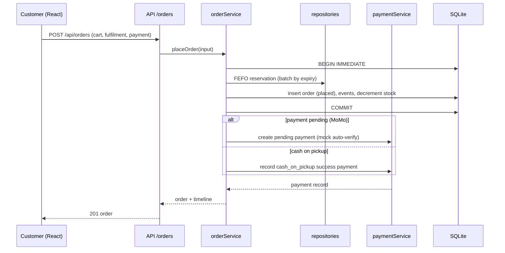
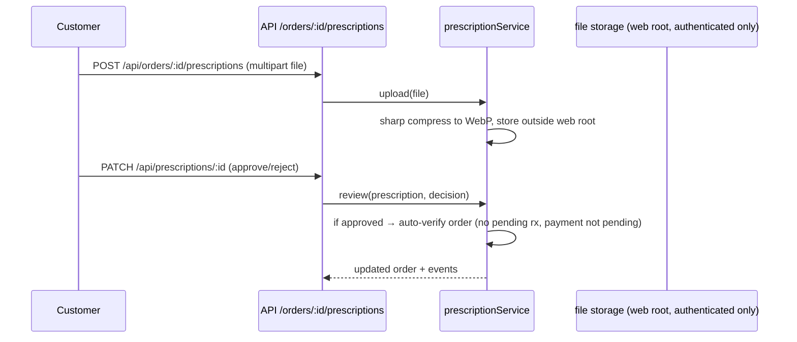
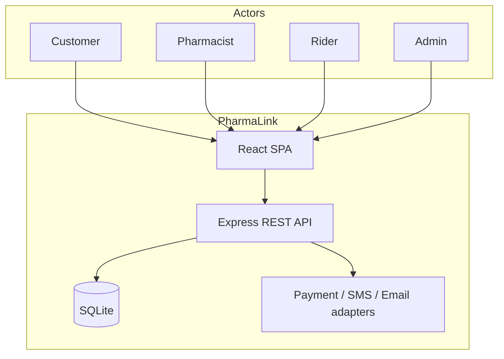
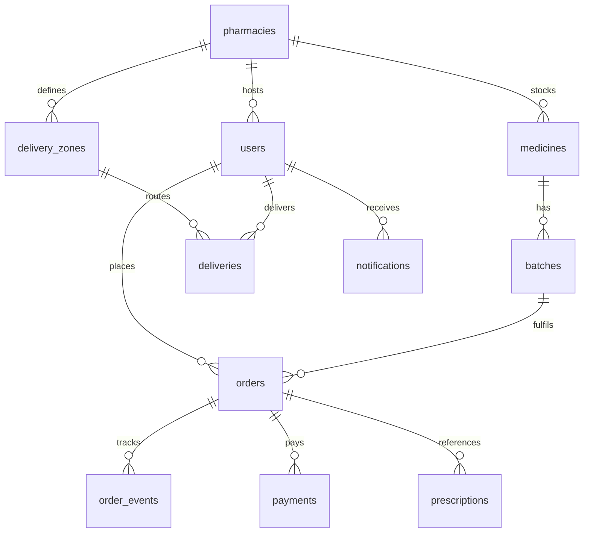
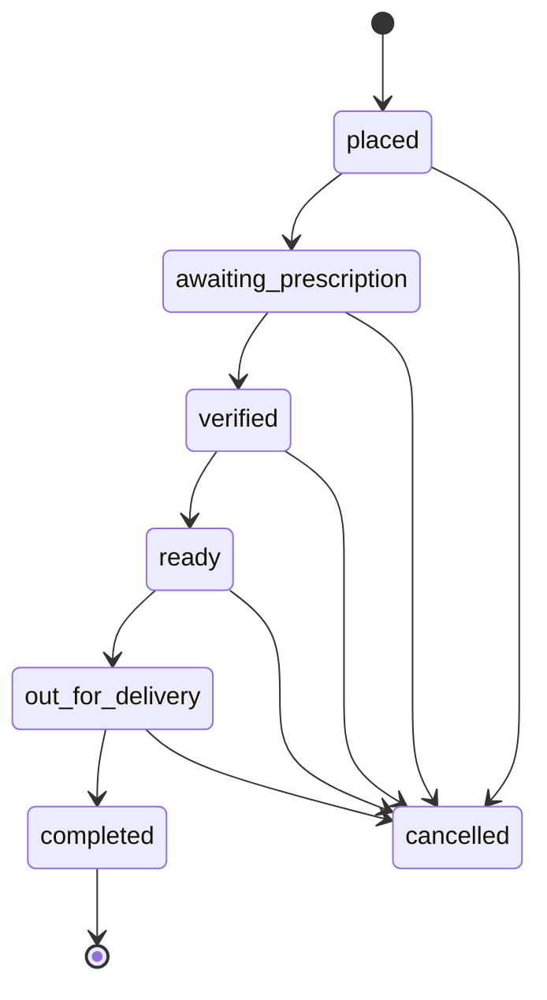

# Architecture

This document describes the PharmaLink system architecture: components, layers, data flow, and key diagrams.

## Overview

```
┌─────────────────────────────┐        ┌──────────────────────────────┐
│  React 18 SPA (client/)      │        │  Express API (server/)        │
│  Vite · React Router ·       │ HTTP/ │  JWT httpOnly cookie +       │
│  plain CSS · Chart.js        │───────►│  CSRF double-submit           │
│                               │  JSON │  helmet · rate-limit ·     │
│  AuthContext · useApi        │◄───────│  compression · CORS allow-list │
└─────────────────────────────┘  JSON │  routes → controllers →       │
                                       │  services → repositories     │
                                       └──────────────┬───────────────┘
                                                      │ better-sqlite3
                                                      ▼
                                       ┌─────────────────────────────┐
                                       │  SQLite (WAL, FK ON, prepared │
                                       │  statements)                 │
                                       └─────────────────────────────┘
```

## Layered backend design

```
Request
  │
  ▼
routes/*        (Express Router, validation via zod, auth/role middleware)
  │
  ▼
controllers/*  (thin handlers, call services, shape JSON responses)
  │
  ▼
services/*     (business rules: orders, inventory, prescriptions, payments, …)
  │
  ▼
repositories/* (better-sqlite3 prepared statements)
  │
  ▼
db/index.js     (connection, WAL/FK pragmas, migration runner)

Cross-cutting: middleware/auth.js (JWT + roles + scoping), middleware/csrf.js,
middleware/upload.js, middleware/rateLimit.js, middleware/error.js,
services/providers/{payment,sms,email}.js (third-party adapters, mock default).
```

### Request flow (authenticated, pharmacy-scoped)

1. Browser sends `Authorization: Bearer <jwt>` (also stored in httpOnly cookie) and `X-CSRF-Token` (double-submit cookie).
2. `authenticate` middleware verifies JWT; `requireRole(...)` checks role.
3. Controllers pass `req.user` (id, role, pharmacyId) so services enforce scoping.
4. Services wrap writes in `BEGIN IMMEDIATE` transactions (stock reservation/deduction, order status transitions, payment capture).
5. Repositories execute prepared statements.
6. Errors mapped via `middleware/error.js` → consistent JSON error envelope.

## Sequence diagrams

### Order placement (customer checkout → pharmacy fulfilment)



Cancelled / failed payments restore reserved stock.

### Prescription review



## Service map (server/src/services)

| Service | Responsibility |
| --- | --- |
| authService | register/login/logout/reset/forgot, JWT issuance, password policy, notifications |
| userService | admin user CRUD, suspend/activate, data subject requests (anonymise) |
| catalogueService | categories, medicines CRUD, public catalogue/search |
| cartService | per-customer single-pharmacy cart persistence |
| orderService | placement, FEFO reservation, status transitions, cancel, reorder, walk-in |
| prescriptionService | upload, queue, review, file privacy, auto-verify |
| paymentService | provider adapters, mock auto-verify / failure, cash on pickup |
| inventoryService | batches, stock levels, alerts, POs, suppliers |
| deliveryService | delivery zones, riders, deliveries, fulfilment transitions |
| notificationService | in-app outbox + SMS/email adapters |
| refillService | scheduled refill reminders |
| analyticsService | sales aggregation, dashboard, demand forecast, safety stock |
| reportsService | CSV/PDF export (stock, expiry, sales, receipts) |
| backupService | DB backup/restore, retention |
| settingsService | operational settings |

## Frontend structure

```
client/src
├── App.jsx                 # route + role map
├── main.jsx
├── api/client.js           # api(), download(), openProtectedFile(), ensureCsrf()
├── context/AuthContext.jsx# session state, login/register/logout/refresh
├── hooks/useApi.js         # data fetching hook
├── components/             # UI kit, StatusBadge, Timeline, PharmacyPicker, Charts, Layout, ProtectedRoute
├── pages/                  # Landing, Login, Register, Forgot/Reset, Profile, Cart, Checkout,
│                            # Search, MedicineDetail, Orders, OrderTracking, Refills, Notifications,
│                            # staff: Dashboard, OrderQueue, PrescriptionQueue, Inventory, Alerts,
│                            #      Deliveries, Zones, Riders, PurchaseOrders, Suppliers, Reports, WalkIn,
│                            # admin: Analytics, Audit, Medicines, Outbox, Settings, Users
└── utils/format.js        # labels, tones, money/date formatting
```

### Role-based routes

| Route prefix | Allowed roles |
| --- | --- |
| `/` `/login` `/register` `/forgot-password` `/reset-password` | public |
| `/search` `/cart` `/checkout` `/orders` `/orders/:id` `/refills` `/notifications` `/profile` | customer |
| `/dashboard` … staff surfaces | pharmacist, admin |
| `/rider` | rider, pharmacist (queue) |

Route guards: `ProtectedRoute` (auth + optional role allow-list), `roleHome` maps role → home route.

## Key design decisions

- **Money**: stored as REAL GHS, rounded to 2 decimals at write time.
- **Order status**: `placed → awaiting_prescription → verified → ready → out_for_delivery → completed`; terminal `cancelled`.
- **FEFO**: orders reserve stock from batches ordered by expiry date (`expiry ASC, batch_number ASC`).
- **Transactions**: `BEGIN IMMEDIATE` around reservation + deduction + event insert.
- **Prescription privacy**: files stored outside web root, served only via authenticated endpoint with ownership checks.
- **Multi-pharmacy**: admin sees all; staff/rider scoped to their own pharmacy unless elevated.

## Deployment notes

- `server/data/*.db` is the SQLite file (git-ignored); run `npm run migrate` and `npm run seed` on a fresh environment.
- Backups: `POST /api/admin/backups`, scheduled via `BACKUP_CRON` (default 02:00 daily).
- Cron jobs: refill reminders and stock alerts (`ENABLE_CRON`).

## Diagrams

### Context diagram



### ER overview



(See [docs/DATABASE.md](DATABASE.md) for the full schema.)

### State diagram — order lifecycle



---

*See also:* [DATABASE.md](DATABASE.md) · [API.md](API.md) · [SECURITY.md](SECURITY.md) · [TEST_PLAN.md](TEST_PLAN.md)
